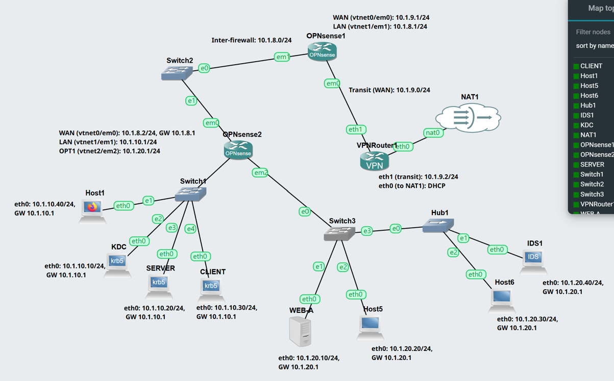
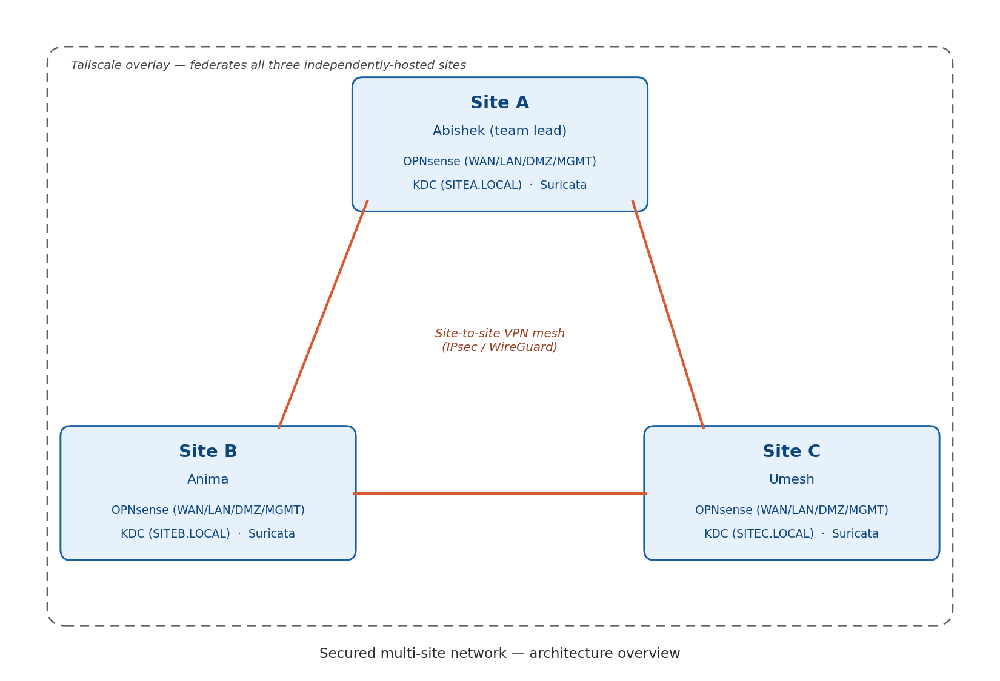

# COIT12202 A2 - Secured Multi-Site Network

Secured multi-site network build (Kerberos, OPNsense, VPN, Suricata) - COIT12202 Assessment 2.
Team: **Abishek** (lead), **Anima**, **Umesh**.
## GNS3 project files

All three sites' `.gns3project` exports are available in this repository's **Releases** section rather than committed directly to the folders, since the files were too large to upload through GitHub's normal web interface.

 [live demonstration](https://youtu.be/ysdmp00cjIk)

> A distributed, three-site network built and secured end-to-end by our team - federated authentication, segmented firewalls, encrypted site-to-site connectivity, and intrusion detection, with every design decision justified in the accompanying report.

## Team

| Name | Role | Site | Realm |
|---|---|---|---|
| Abishek | Team leader | Site A | `SITEA.LOCAL` |
| Anima | Member | Site B | `SITEB.LOCAL` |
| Umesh | Member | Site C | `SITEC.LOCAL` |

## Site A network topology (as-built)



Two firewalls (edge + internal), full addressing labelled on the diagram. Sites B and C follow a simpler single-firewall pattern, since a second firewall isn't required by the spec.

## Architecture overview

Three sites, each running an OPNsense firewall (Site A runs two), WAN/LAN/DMZ zones, a local Kerberos KDC, and Suricata - federated over a shared Tailscale overlay, with an encrypted site-to-site VPN mesh (IPsec) carrying the real inter-site traffic on top of it, terminating on each site's OPNsense WAN interface (not the VPN router), per the unit's own reference material.



*(Full diagrams - overview and per-site zone detail - are also in [`A2-Team-Plan-Architecture.docx`](A2-Team-Plan-Architecture.docx).)*

## Repository structure

```
.
├── SiteA_ByAbishek/                # Abishek - configs/, Images/, captures/, evidence .md files (CA/HTTPS, SSH, password policy, DMZ) - .gns3project still to add
├── SiteB_ByAnima/                  # Anima - Images/, evidence .md files - configs/ and .gns3project still to add
├── SiteC_ByUmesh/                  # Umesh - SiteC_Umesh_Final.gns3, SITE C IMAGES/ - configs/ still to add
├── captures/                       # Shared .pcap/.pcapng evidence (VPN before/after, etc.)
├── report/
│   └── report.md                   # Security-justification report
├── report/images/                    # Diagram exports used in this README
├── network-diagram.drawio          # Multi-site network diagram
├── ADDRESSING.md                   # IP/realm/VPN addressing scheme - source of truth
├── RUBRIC-CHECKLIST.md             # Marking rubric tracked as a checklist
├── A2-Team-Plan-Architecture.docx  # Architecture diagrams + task distribution
└── README.md
```

Each site folder has its own `README.md` explaining exactly what goes where.

## Key docs

- [`ADDRESSING.md`](ADDRESSING.md) - IP addressing, Kerberos realms, VPN tunnel subnets
- [`RUBRIC-CHECKLIST.md`](RUBRIC-CHECKLIST.md) - full marking rubric mapped to a checklist
- [`A2-Team-Plan-Architecture.docx`](A2-Team-Plan-Architecture.docx) - architecture diagrams and task distribution
- [`report/report.md`](report/report.md) - security-justification report *(in progress)*
- [`SiteA_ByAbishek/README.md`](SiteA_ByAbishek/README.md) - Site A's private CA + HTTPS evidence
- [`SiteA_ByAbishek/SSH-Hardening-Evidence.md`](SiteA_ByAbishek/SSH-Hardening-Evidence.md) - Site A's Week 4 SSH hardening + fail2ban evidence
- [`SiteA_ByAbishek/Password-Policy-Evidence.md`](SiteA_ByAbishek/Password-Policy-Evidence.md) - Site A's Week 3 password policy + account lockout evidence
- [`SiteA_ByAbishek/OPT1-DMZ-Segmentation-Evidence.md`](SiteA_ByAbishek/OPT1-DMZ-Segmentation-Evidence.md) - Site A's DMZ/LAN zone segmentation evidence (Criterion 2)

## How the sites connect

1. **Tailscale overlay** - federates the three independently-hosted GNS3 topologies so they can reach each other over the real internet.
2. **Site-to-site VPN (IPsec/WireGuard)** - encrypted tunnels between each pair of OPNsense firewalls, carried over that Tailscale reachability.
3. **Cross-realm Kerberos** - each site runs its own KDC and realm; cross-realm trust lets a user at one site authenticate to resources at another.
4. **Suricata** - a consistent detection policy deployed at each site's LAN/WAN boundary.

## Planning

Tracked on our GitHub Project (Kanban board) - kept current throughout the build, not backfilled at the end. Day-to-day communication happens in our Microsoft Teams channel.

## Status

**Site A (Abishek)** - both firewalls configured and GUI access working, Kerberos proven end-to-end (positive and negative GSSAPI login, packet capture confirmed), Tailscale live and confirmed reaching Site B, Suricata running with both custom rules firing. Site A-to-Site B connectivity over the Tailscale-carried transit link was re-confirmed this morning from a real Site A LAN host: `CLIENT` (`10.1.10.30`) pinged Site B's VPN router (`10.2.9.2`) with 5/5 replies, 0% loss (live terminal screenshot), with a matching packet capture on the `OPNsense1`-`VPNRouter1` link - see `SiteA_ByAbishek/captures/README.md` for the capture detail, including the outbound-NAT caveat that makes the capture itself show `10.1.9.1` as the source rather than the true LAN IP. Site-to-site IPsec is now confirmed established from Site A's own console for Site C (`ipsec statusall` on OPNsense1 shows `con2` ESTABLISHED, CHILD_SA installed, matching Site C's side); the tunnel to Site B is configured and confirmed established from Site B's own console. OPT1/DMZ zone segmentation is now real and saved (not the firewall-disabled workaround) - named aliases, an explicit logged deny rule, and a live-tested block, see [`SiteA_ByAbishek/OPT1-DMZ-Segmentation-Evidence.md`](SiteA_ByAbishek/OPT1-DMZ-Segmentation-Evidence.md). Week 3/4 labs (password policy on `UbuntuHost1`, SSH hardening + fail2ban on `SERVER`) are integrated into the topology and now fully screenshotted - see [`SiteA_ByAbishek/Password-Policy-Evidence.md`](SiteA_ByAbishek/Password-Policy-Evidence.md) and [`SiteA_ByAbishek/SSH-Hardening-Evidence.md`](SiteA_ByAbishek/SSH-Hardening-Evidence.md). `.gns3project` export is included in the repository's Releases section. A private root/intermediate CA was built and used to issue a certificate for `www.sitea.local`; nginx serves it correctly and a separate client verifies the full chain (`openssl verify` -> OK, `curl --cacert` returns the page) without disabling certificate checks - see [`SiteA_ByAbishek/README.md`](SiteA_ByAbishek/README.md).

**Site B (Anima)** - OPNsense-B is now genuinely built, not diagram-only: real, saved, scoped WAN rules (confirmed via screenshot, "changes applied successfully"), and the Site A<->B IPsec tunnel is confirmed established from Site B's own console (`ipsec statusall` shows `con1` ESTABLISHED, CHILD_SA installed, real ESP traffic counted). Kerberos built past where Site A had reached at the equivalent point - KDC, principals, keytab, and an actual client ticket already obtained. Week 4 SSH hardening evidenced (Ed25519 client key generated - see her own `SSH-Hardening-Evidence.md`). A Site B PKI/HTTPS build mirroring Site A's CA work is included. IDS-B has both a management address and routing configured, with Suricata evidence collected. Tailscale connected to the shared tailnet.

**Site C (Umesh)** - full topology built and wired, with a `.gns3project` export now committed to the repo. OPNsense-C fully configured (WAN rules scoped correctly to Site A's and Site B's transit ranges, LAN/OPT1 rules, DMZ connectivity proven). Kerberos is now complete locally: KDC database, principals, and keytabs are in place, and both `kinit`/`klist` (client) and keytab-based auth (server) have been demonstrated. Tailscale is configured to advertise `10.3.0.0/16`, and the subnet route is confirmed **approved** in the admin console (screenshot verified - this corrects the earlier "still pending" status). Site-to-site IPsec to Site A is confirmed up: IKE_SA and CHILD_SA established, and real ESP traffic between `10.3.9.1` and `10.1.9.1` was captured live. IPsec to Site B has Phase 1 + Phase 2 configured. Suricata is running with a custom rule firing on ICMP.

Detailed, up-to-date status lives in each site's own `README.md`.


