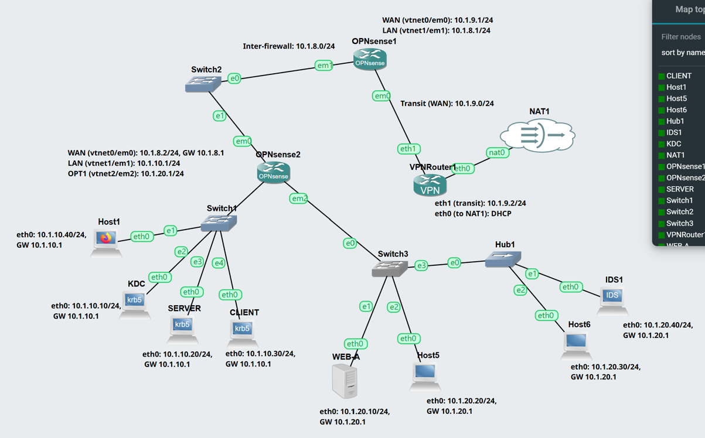

# Images

Screenshots and diagrams for Site A.

`SiteA_Topology.png` - the actual GNS3 canvas showing the full built topology (two firewalls, transit segment, LAN, DMZ, VPNRouter1, IDS1/Hub1), with every address labelled.

## What's already here

- Kerberos build evidence (`kerberos-02` through `-04`) - KDC database init, principals/keytab, GSSAPI positive and negative proof
- OPNsense interface banners and the WAN-rule bug fix, before and after (`opnsense1-*`, `opnsense2-*`)
- Tailscale setup and admin console confirmation (`tailscale-01`, `tailscale-02`)
- IPsec Phase 1 to Site B (`opnsense1-ipsec-phase1-enabled-siteb.png`)
- Suricata rules loaded and both alerts fired (`suricata-ids1-*`), plus the traffic that triggered them (`host5-curl-host6-webserver.png`, `host6-access-log-confirms-host5-request.png`)
- DMZ connectivity proof (`topology-dmz-ping-server-to-host6.png`), VNC bridge confirmation (`host1-firefox-vnc-ip-confirm.png`)

## Still to add (Site A only)

- IPsec Phase 1 to Site C, once configured on OPNsense1
- VPN before/after packet capture screenshots

Naming convention: `<what>-<detail>.png`, e.g. `opnsense1-interfaces.png`, `ping-kdc.png`, `kerberos-03-principals.png`.
