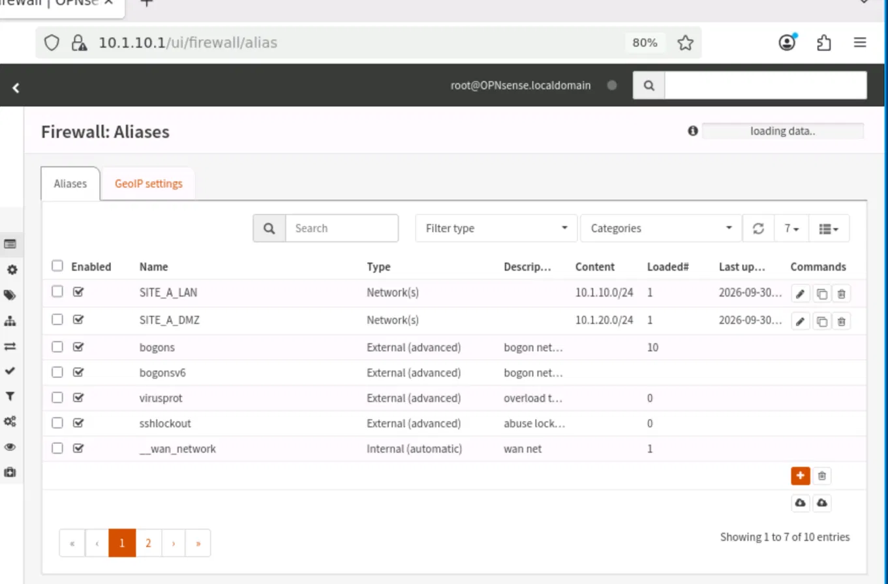
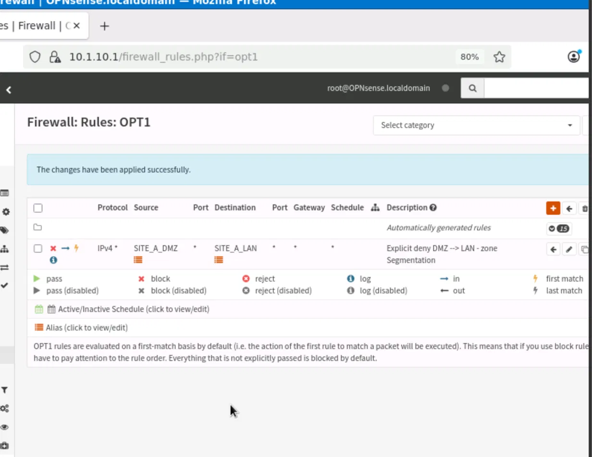
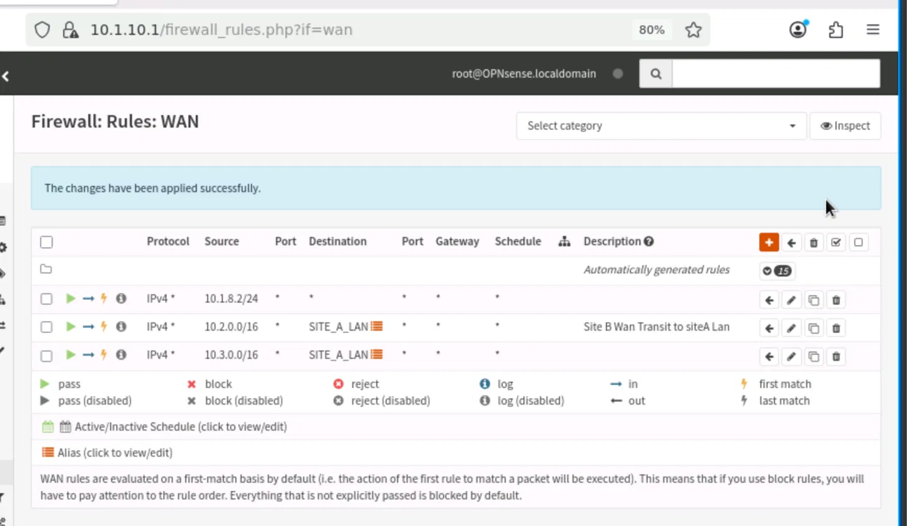
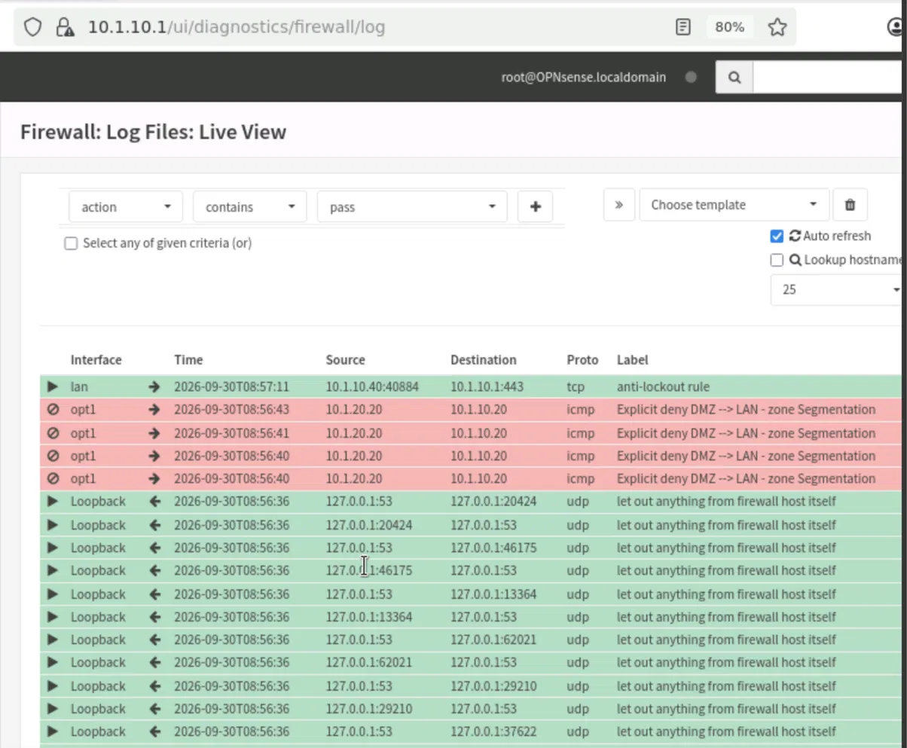

# Site A - Criterion 2 Evidence: OPT1/DMZ Zone Segmentation

**Site:** A (Abishek) | **Firewall:** OPNsense2 (`10.1.10.1`) | **Zones:** LAN (`10.1.10.0/24`), DMZ/OPT1 (`10.1.20.0/24`)

This documents replacing the earlier "firewall temporarily disabled" test with real, saved
firewall rules proving DMZ/LAN zone segmentation on OPNsense2, per the A2 rubric's Criterion 2
requirement for "rules per zone" backed by live log evidence - not just a config file.

## What was done

1. **Named aliases created** (Firewall > Aliases), matching the same approach Site C uses
   instead of scattering raw subnets across rules:
   - `SITE_A_LAN` - Network alias, `10.1.10.0/24`
   - `SITE_A_DMZ` - Network alias, `10.1.20.0/24`
   

2. **Explicit deny rule added on OPT1** (the DMZ-facing interface) - `SITE_A_DMZ` -> `SITE_A_LAN`,
   action Block, logging enabled, description "Explicit deny DMZ -> LAN - zone Segmentation".
   No pass rule exists on OPT1 permitting DMZ to initiate into LAN, so if the DMZ webserver were
   ever compromised, it cannot reach into Site A's LAN.
   

3. **Cross-site pass rules corrected onto the WAN interface** - `10.2.0.0/16 -> SITE_A_LAN` and
   `10.3.0.0/16 -> SITE_A_LAN`, both Pass. These were initially added to the LAN tab by mistake,
   which would have made them silently ineffective (traffic from Site B/C enters OPNsense2 via
   its WAN interface, relayed through OPNsense1 - not via LAN), so they were moved to the correct
   WAN tab and scoped to `SITE_A_LAN` rather than "any", to avoid also opening DMZ access.
   

4. **Live block tested end-to-end** - from the `webserver` node (DMZ, `10.1.20.20`):
   ```
   ping -c 4 10.1.10.20
   ```
   Result: no replies (blocked). Firewall > Log Files > Live View, filtered on the OPT1
   interface, shows the block firing in real time against the actual attempt:
   ```
   opt1  10.1.20.20 -> 10.1.10.20  icmp  Explicit deny DMZ --> LAN - zone Segmentation
   ```
   (repeated once per ICMP echo request sent, four entries total, timestamps matching the test.)
   

## Result

OPNsense2 now enforces DMZ/LAN segmentation with a real, saved, logged rule - not a temporarily
disabled firewall - while still allowing Site B and Site C's subnets to reach Site A's LAN (per
the IPsec Phase 2 traffic selectors) and Site A's own LAN to reach its DMZ webserver. The block
was tested live and confirmed in the firewall's own log, not just configured and assumed working.

## Known follow-up

The two cross-site rules were briefly duplicated on the LAN tab during setup, before being
correctly moved to WAN - those leftover, inactive LAN-tab copies should be deleted for a clean
rule list, though they don't affect behaviour (rules on the LAN tab never see WAN-sourced
traffic either way).

## Note on rubric mapping

Maps to **Criterion 2 (Firewalls & zones)** - "Rules per zone" and "Live log evidence showing
blocked traffic enforced as intended." See `RUBRIC-CHECKLIST.md` Section 2.
