# Site A - owned by Abishek

Realm: `SITEA.LOCAL` - Supernet: `10.1.0.0/16` - two firewalls (edge + internal)

## Folder contents

- `Addressing.md` - full addressing scheme, table form
- `configs/` - Kerberos build record, OPNsense config notes
- `captures/` - packet capture evidence
- `Images/` - all screenshots referenced above, plus additional connectivity/config evidence not shown inline here

## Network topology

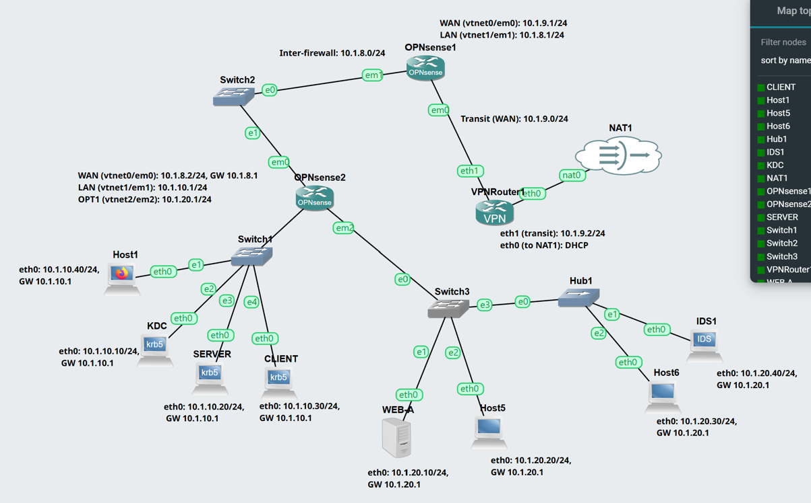

Full addressing is labelled directly on the diagram. See `Addressing.md` for the same information as a table.

## Status

- [x] Topology built and wired (two firewalls: OPNsense1 edge, OPNsense2 internal)
- [x] All hosts, VPNRouter1, IDS1 addressed
- [x] Kerberos realm renamed to `SITEA.LOCAL` on KDC/SERVER/CLIENT
- [x] OPNsense1 and OPNsense2 console configuration (interfaces, IP addressing)
- [x] OPNsense1 and OPNsense2 WAN and OPT1 firewall rules
- [x] GUI access (VNC bridge via Host1's Firefox)
- [x] KDC database, principals, keytab, GSSAPI test (positive and negative proof)
- [x] Kerberos packet capture confirmed (`captures/ClintToSwitchSiteA.pcap`)
- [x] Tailscale on VPNRouter1 - live, route approved, confirmed reaching Site B
- [x] Site-to-site VPN Phase 1 (IKE) on OPNsense1 - Site B (10.2.9.1) and Site C (10.3.9.1), both IKEv2, enabled
- [x] IPsec interface Pass rule added on OPNsense1, ahead of Phase 2 existing
- [ ] Site-to-site VPN Phase 2 - subnet pairing sent to Anima and Umesh for confirmation
- [ ] VPN before/after packet capture
- [x] Suricata ruleset on IDS1
- [ ] `.gns3project` export added to this folder (still outstanding)

## Evidence

**Kerberos**

| | |
|---|---|
| 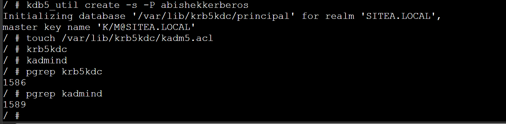 |  |
| KDC database initialised, both daemons running | All principals created, keytab exported |

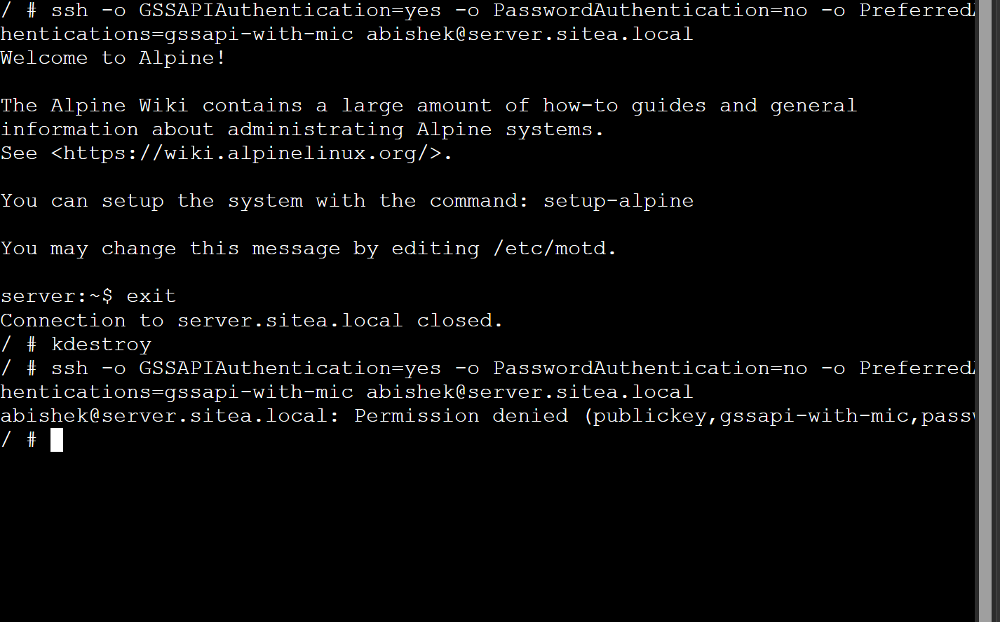

Login succeeds with a valid ticket, fails once `kdestroy` removes it - proof the ticket, not something else, is what authenticated the login.

**OPNsense - diagnosing and fixing a real bug**

| Before | After |
|---|---|
|  | 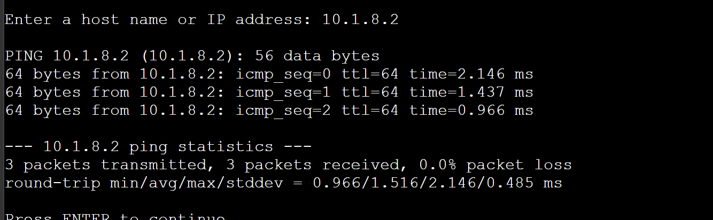 |
| 100% packet loss - WAN had no Pass rule | 0% loss, after adding one |

Unticking "Block private networks" alone wasn't enough - an explicit WAN Pass rule was needed on top. See `Images/opnsense2-wan-rule-creation.png` for the rule itself.

**Tailscale**

VPNRouter1 live on the shared tailnet, `10.1.0.0/16` advertised and approved.

**IPsec - Phase 1 to Site B and Site C**

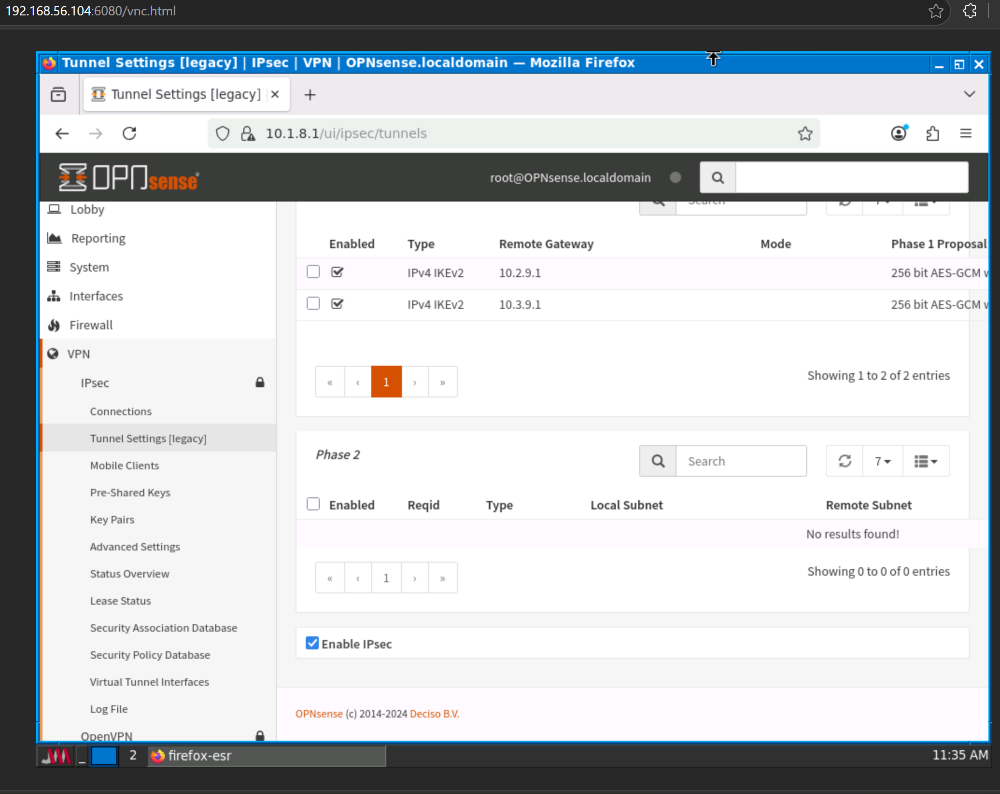

Two IKEv2 tunnels on OPNsense1, both enabled: `10.2.9.1` (Site B) and `10.3.9.1` (Site C), both 256-bit AES-GCM. Phase 2 still empty for both - subnet pairing (each site's full `/16`) sent to Anima and Umesh for confirmation before configuring.

**IPsec firewall rules - both peers covered**

| | |
|---|---|
| 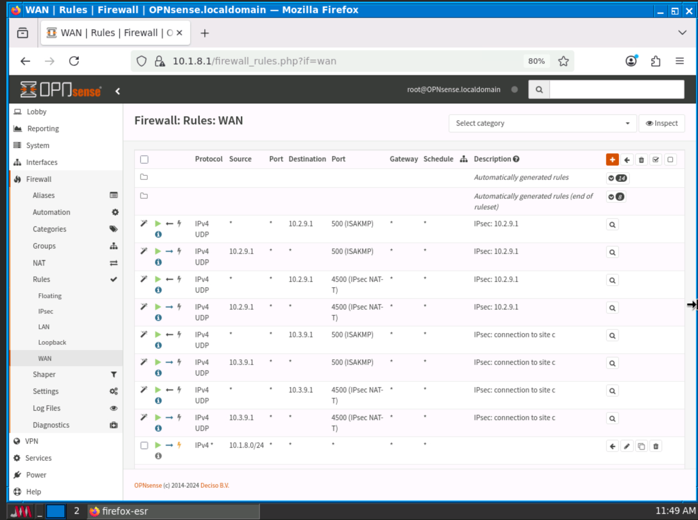 | 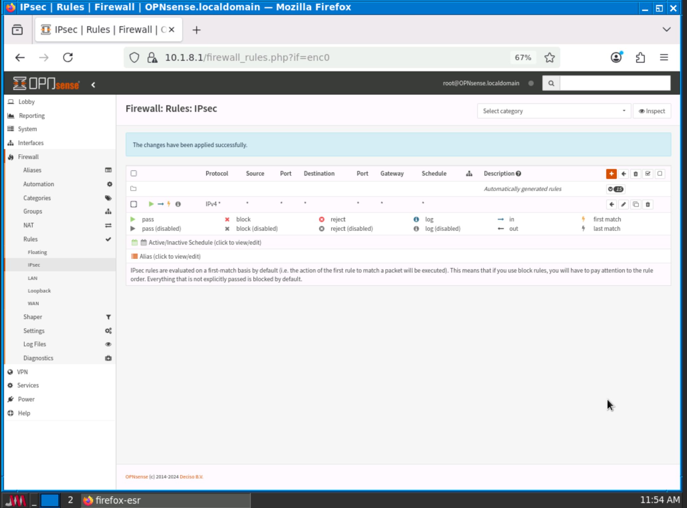 |
| Auto-generated UDP 500/4500 rules for both peers (`10.2.9.1`, `10.3.9.1`) | Pass rule added on the IPsec interface itself - caught before Phase 2 existed, not after |

**Suricata**

| | |
|---|---|
| 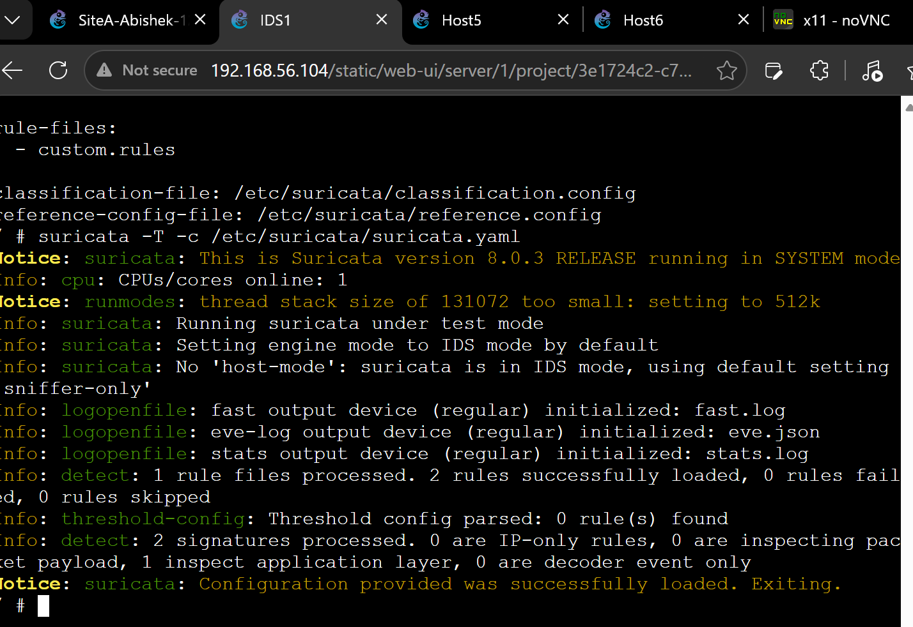 | 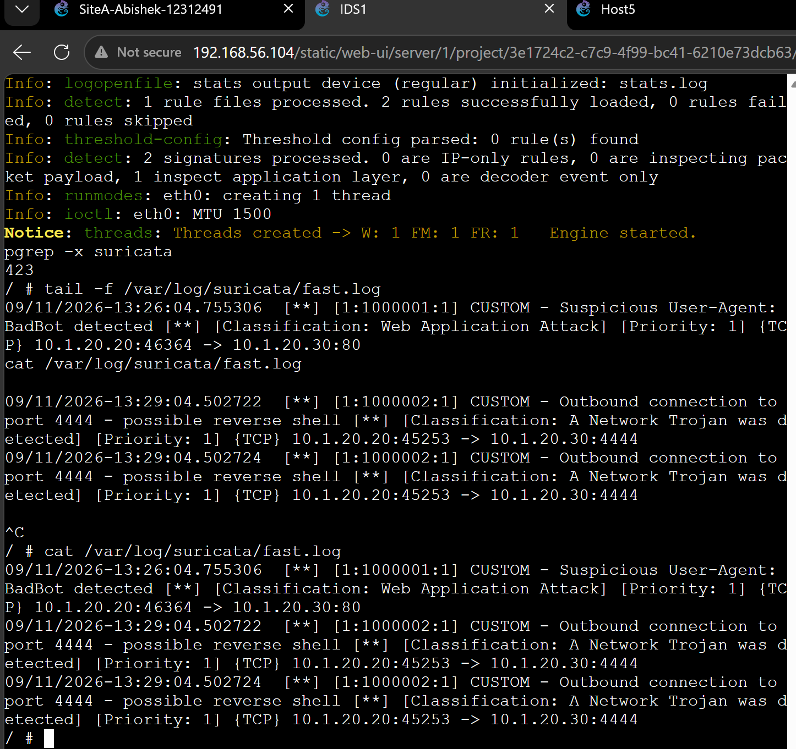 |
| 2/2 custom rules loaded, 0 failed | Both fired: suspicious User-Agent ("BadBot"), and a port-4444 reverse-shell pattern |

Traffic that triggered it:

| | |
|---|---|
| 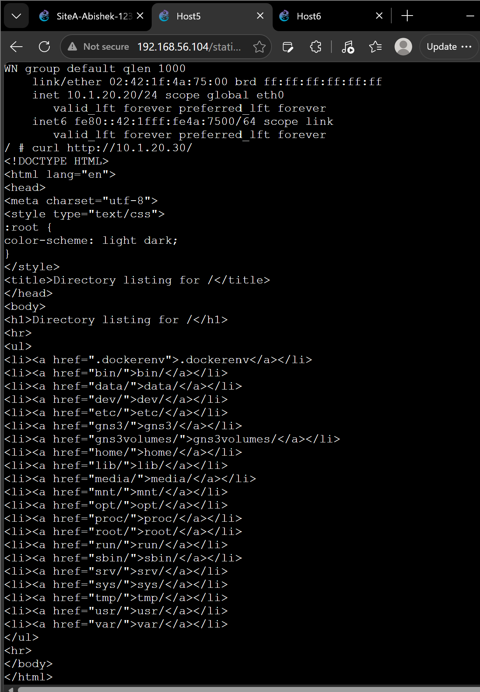 | 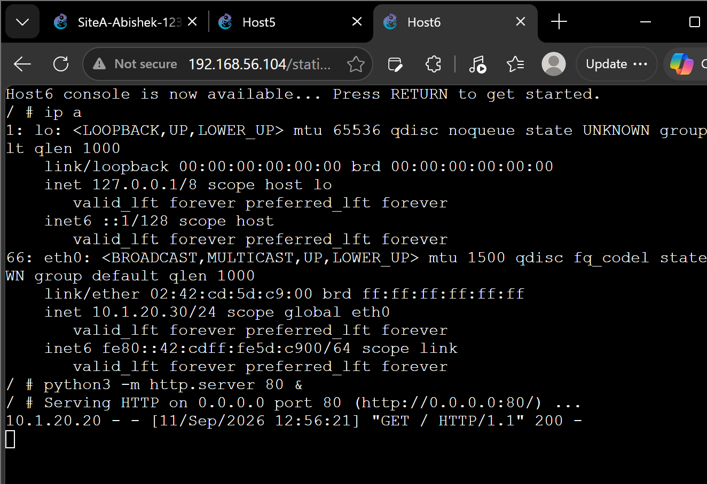 |
| Host5 (`10.1.20.20`) curls Host6 (`10.1.20.30`) | Host6's access log confirms the request - matches Suricata's alert source/destination exactly |
