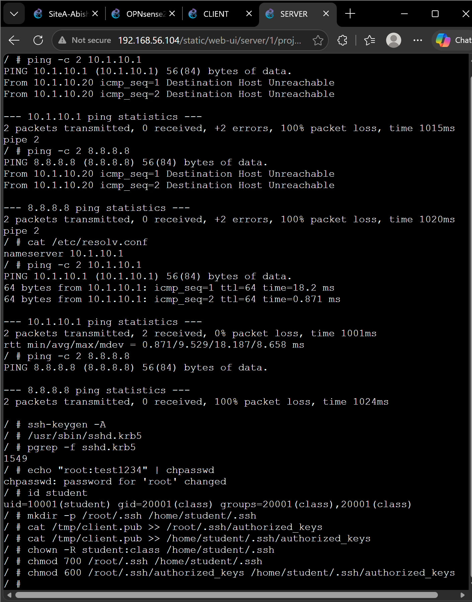
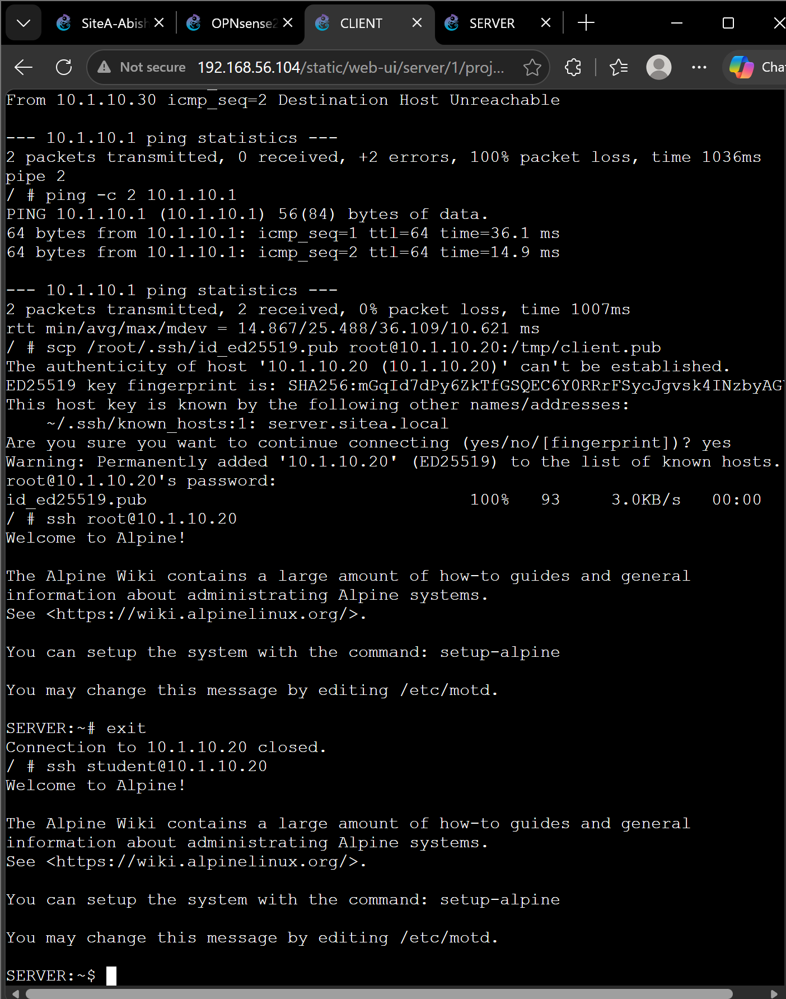
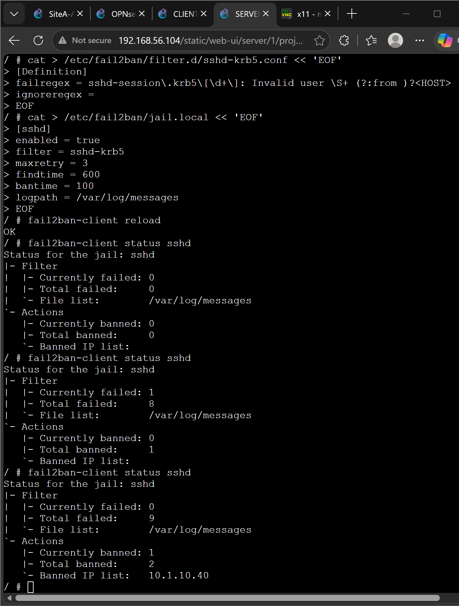
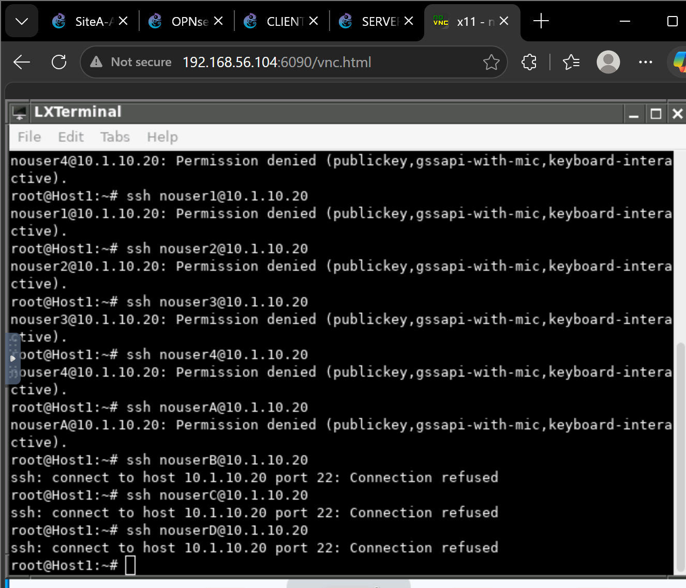

# Site A - Week 4 Evidence: Hardened SSH Host (SERVER)

**Site:** A (Abishek) | **Host:** `SERVER` (`10.1.10.20/24`, LAN) | **Image:** `cqugns3/auth-kerberos`

This documents hardening the SSH service on Site A's LAN host `SERVER`, integrating the
Week 4 SSH-Hardening lab into the actual A2 topology, per the A2 spec's requirement to bring
"your hardened SSH host" into the built network, and the rubric's Criterion 2 requirement that
the LAN zone hold this as a real, running service.

## What was done

1. **Image quirk found and fixed** - this node's image (`cqugns3/auth-kerberos`, the same
   Kerberos-patched image used for KDC/SERVER/CLIENT) ships no plain `sshd` binary, only
   `sshd.krb5`. The default `start-ssh.sh` script fails with `/usr/sbin/sshd: not found`.
   Fixed by generating host keys directly (`ssh-keygen -A`) and starting
   `/usr/sbin/sshd.krb5` directly, confirmed running via `pgrep -f sshd.krb5`.
   

2. **Key-based authentication configured** - an Ed25519 keypair was generated and the public
   key installed into the pre-existing `student` account's `~/.ssh/authorized_keys`
   (account/group confirmed via `id student` -> `uid=10001(student) gid=20001(class)`).
   

3. **`sshd_config` hardened** with:
   - `PermitRootLogin no`
   - `MaxAuthTries 3`
   - `AllowUsers student`
   - `PasswordAuthentication no`

4. **Login behaviour verified**:
   - Root login: refused
   - `student` with the installed key: succeeds
   - Password authentication (any account): refused, key-only

   See the client-side screenshot above (step 2) - it shows the key-based login succeeding.

5. **fail2ban configured and proven live** - the stock `sshd` filter never matched, because
   this image logs as `sshd-session.krb5[PID]: ...` rather than the usual `sshd[PID]: ...`.
   A custom filter was written to match the real log format:

   `/etc/fail2ban/filter.d/sshd-krb5.conf`
   ```
   failregex = sshd-session\.krb5\[\d+\]: Invalid user \S+ (?:from )?<HOST>
   ```

   `jail.local` updated to use `filter = sshd-krb5`, `logpath = /var/log/messages`,
   `maxretry = 3`, `findtime = 600`, `bantime = 100`, then `fail2ban-client reload`.
   

6. **Brute-force attack simulated from `Host1` (`10.1.10.40`)** - repeated invalid logins
   (`ssh nouser1@10.1.10.20`, `nouser2`, `nouser3`, `nouser4`, repeated) produced a real ban:

   ```
   fail2ban-client status sshd-krb5
   Total failed:      8
   Total banned:       2
   Currently banned:   1
   Banned IP list:     10.1.10.40
   ```
   

## Result

`SERVER` on Site A's LAN enforces key-only SSH login (root disabled, password auth disabled,
`student`-only via Ed25519 key) and actively bans a brute-forcing source IP via fail2ban,
using a filter written specifically for this image's non-standard log tag. This satisfies the
A2 rubric's requirement for "the hardened SSH host on the LAN" as a real, running, tested
service - not just a config file.

**Evidence status:** commands and output above are transcribed directly from the live GNS3
console session, and are now backed by screenshots in `Images/` (linked inline above) matching
the Week 2 CA/HTTPS evidence pattern.

## Note on rubric mapping

Maps to **Criterion 2 (Firewalls & zones)** - the A2 spec explicitly asks for "your hardened
SSH host" to be brought into the built topology, and the rubric requires the LAN zone to hold
this as an actual running service, not just a firewall rule. This is that service.
