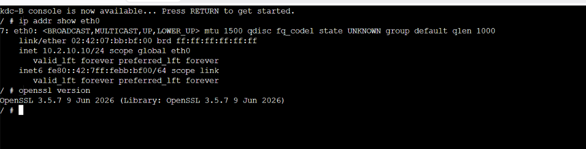
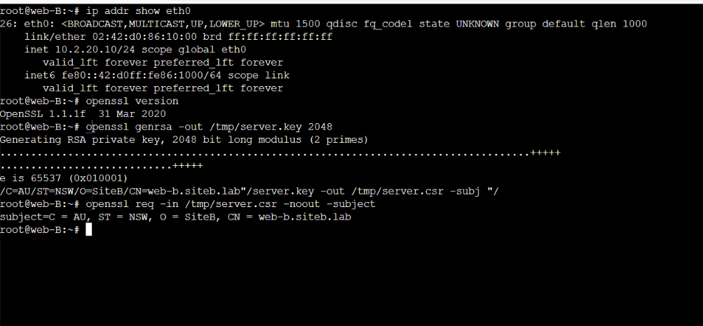
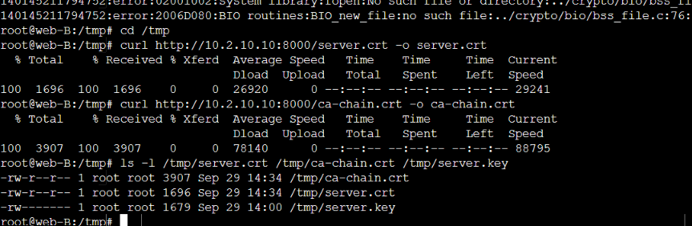
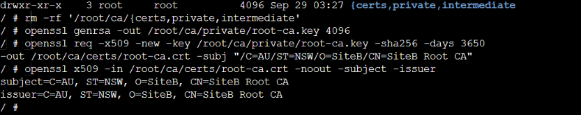
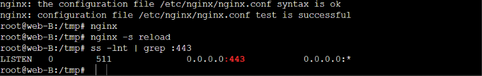
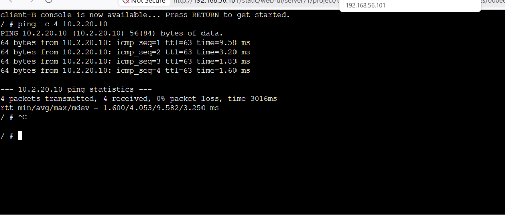

# Site B - Week 2 Evidence: CA + HTTPS Server

**Site:** B (Anima) | **Realm/domain:** `SITEB.LOCAL` | **Service host:** `web-b.siteb.lab` (`10.2.20.10`)

This evidence documents the Site B private Certificate Authority setup and HTTPS server configuration. A Root CA and Intermediate CA were created on `kdc-B`, a certificate was issued for the Site B web server, and nginx was configured to serve HTTPS on `web-B`.

---

## 1. PKI / OpenSSL Environment

The PKI configuration was performed on `kdc-B` (`10.2.10.10`) using OpenSSL.

---

## 2. Root CA Created

A Site B Root CA was created on `kdc-B`.

The Root CA certificate uses:

- `CN=SiteB Root CA`
- CA host: `10.2.10.10`

The certificate subject and issuer were verified successfully.

---

## 3. Intermediate CA Created and Verified

An Intermediate CA key and CSR were generated and the Intermediate CA was signed by the Site B Root CA.

Verification was performed using:

`openssl verify -CAfile /root/ca/certs/root-ca.crt /root/ca/intermediate/certs/intermediate.crt`

The verification returned:

`OK`

---

## 4. web-B CSR Created

A Certificate Signing Request (CSR) was created for the Site B HTTPS server.

Certificate identity:

- **Hostname:** `web-b.siteb.lab`
- **IP address:** `10.2.20.10`

The CSR was configured with the required server certificate information and Subject Alternative Name.

---

## 5. web-B Certificate Signed

The `web-B` CSR was signed using the Site B Intermediate CA.

The resulting server certificate was verified against the Root CA and Intermediate CA chain.

The verification returned:

`/tmp/server.crt: OK`

This establishes the Site B certificate hierarchy:

`Root CA -> Intermediate CA -> web-B Server Certificate`

---

## 6. Certificate Files Installed on web-B

The required certificate files were placed on `web-B`.

These included:

- `server.key`
- `server.crt`
- `ca-chain.crt`

---

## 7. nginx HTTPS Configuration

nginx was configured on `web-B` to use the server certificate and private key.

The HTTPS configuration uses:

- `/etc/ssl/private/server.key`
- `/etc/ssl/certs/server-fullchain.crt`
- Hostname: `web-b.siteb.lab`
- HTTPS port: `443`

The nginx configuration was checked using:

`nginx -t`

The configuration test completed successfully.

---

## 8. HTTPS Port 443 Listening

After validating the nginx configuration, the web service was started/reloaded.

TCP port `443` was confirmed as listening on `web-B`.

---

## 9. Client-B to web-B Connectivity

Network connectivity between the Site B client and `web-B` was tested successfully.

- **web-B:** `10.2.20.10`
- **Zone:** DMZ

---

## Result

Site B now has a private two-tier PKI structure:

`Root CA -> Intermediate CA -> web-B Server Certificate`

The Site B web server is configured with the signed certificate and nginx is listening for HTTPS traffic on TCP port `443`.

The server certificate chain was successfully verified during the certificate-issuance process, and the nginx configuration was validated successfully.

---

## Current Evidence Status

Completed and evidenced:

- Root CA creation
- Intermediate CA creation and verification
- `web-B` CSR creation
- `web-B` certificate signing
- Certificate chain verification
- Certificate/key files installed on `web-B`
- nginx HTTPS configuration
- nginx configuration validation
- HTTPS port `443` listening
- Client-B to web-B network connectivity

A separate final client-side trusted HTTPS verification using the Root CA as the trust anchor should only be claimed if that test is completed and evidenced.

---

## Security Notes

Private CA keys and server private keys must not be committed to the GitHub repository.

Only screenshots, public certificates, sanitized configuration documentation, and other non-sensitive evidence should be stored in the repository.

---

## Assignment Mapping

This Week 2 implementation contributes the Site B Certificate Authority and HTTPS server required in the integrated network topology.

The control provides:

- Certificate-based server identity
- Encrypted HTTPS communication
- Root CA / Intermediate CA trust hierarchy
- DMZ-hosted secured web service
