[Images.md](https://github.com/user-attachments/files/32838319/Images.md)

# Site B - Screenshot Evidence

**Site:** B (Anima)\
**Network:** `10.2.0.0/16`

This file indexes the Site B screenshots stored in the `Images/` folder.
The evidence covers the Site B topology, OPNsense addressing and
firewall configuration, Kerberos, Tailscale, IPsec, IDS/Suricata,
PKI/HTTPS, and Week 3/4 security work.

> **Note:** Keep the image files inside the repository's `Images/`
> folder so the links below work.

------------------------------------------------------------------------

## 1. Site B Network Topology

Shows the integrated Site B GNS3 topology, including OPNsense-B,
VPNRouter-B, LAN hosts, DMZ hosts, web-B and IDS-B.

------------------------------------------------------------------------

## 2. OPNsense-B Interface Addressing

Shows the configured OPNsense-B interfaces and Site B addressing.

------------------------------------------------------------------------

## 3. OPNsense-B WAN Gateway

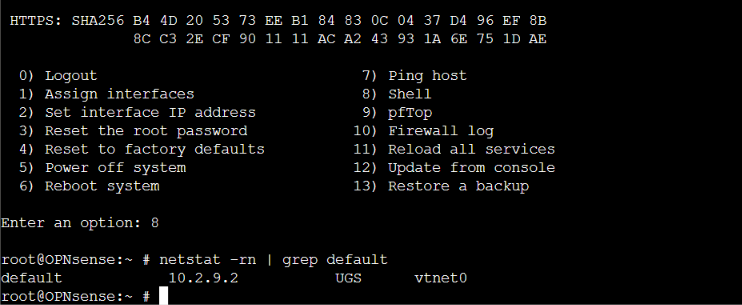

Shows the Site B WAN gateway configuration/verification.

------------------------------------------------------------------------

## 4. OPNsense-B WAN Firewall Rule

Shows the configured WAN firewall rule on OPNsense-B.

------------------------------------------------------------------------

## 5. OPNsense-B WAN Firewall Rules Applied

Shows the applied OPNsense-B WAN firewall rules.

------------------------------------------------------------------------

## 6. Private/Bogon Blocking Setting

Shows the WAN private/bogon blocking setting used for the Site B lab
environment.

------------------------------------------------------------------------

## 7. OPNsense-B Interface Connectivity

Shows connectivity testing across the configured OPNsense-B interfaces.

------------------------------------------------------------------------

## 8. OPNsense-B Internet Connectivity

Shows successful external connectivity from OPNsense-B.

------------------------------------------------------------------------

## 9. VPNRouter-B Internet Connectivity

Shows successful Internet connectivity from VPNRouter-B.

------------------------------------------------------------------------

## 10. Tailscale Site B Connection

Shows VPNRouter-B connected to the Site B Tailscale environment.

------------------------------------------------------------------------

## 11. Tailscale Site B Advertised Route

Shows the Site B route advertisement for `10.2.0.0/16`.

------------------------------------------------------------------------

## 12. Site B IPsec

Shows the Site B IPsec configuration/status evidence.

------------------------------------------------------------------------

# Kerberos Evidence

## 13. Site B Kerberos Realm Configuration

Shows the Site B Kerberos realm configuration.

------------------------------------------------------------------------

## 14. Site B KDC Database

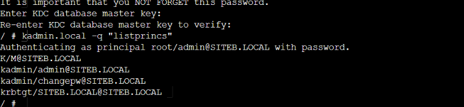

Shows creation/configuration of the Site B Kerberos KDC database.

------------------------------------------------------------------------

## 15. Site B Kerberos Principals

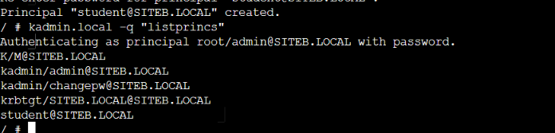

Shows the Kerberos principals configured for Site B.

------------------------------------------------------------------------

## 16. Site B Server Keytab

Shows the Site B server keytab configuration.

------------------------------------------------------------------------

## 17. Site B Server Keytab Installed

Shows the server keytab installed on the Site B server.

------------------------------------------------------------------------

## 18. Site B Client Ticket

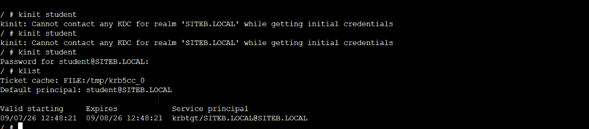

Shows Kerberos ticket acquisition from the Site B client.

------------------------------------------------------------------------

## 19. Site B Client Ticket Verified

Shows verification of the Site B Kerberos client ticket.

------------------------------------------------------------------------

## 20. Site B Service Ticket

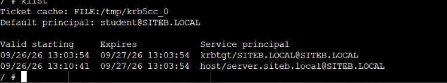

Shows the Kerberos service ticket used for the Site B service.

------------------------------------------------------------------------

## 21. Server-B GSSAPI SSH

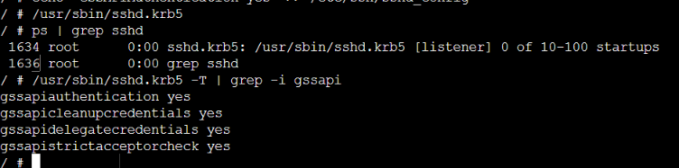

Shows GSSAPI SSH configuration/evidence on Server-B.

------------------------------------------------------------------------

## 22. Server-B OpenSSH

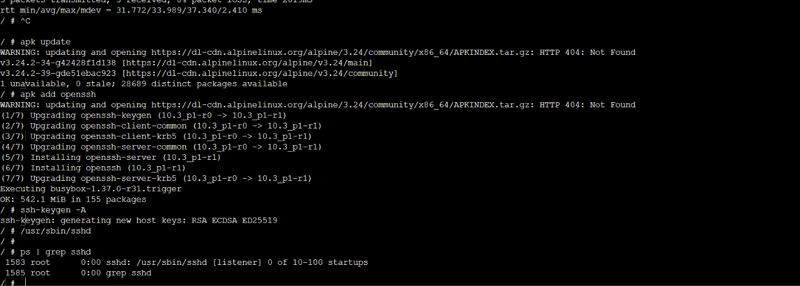

Shows OpenSSH evidence from Server-B.

------------------------------------------------------------------------

## 23. Server-B Internet Connectivity

Shows network connectivity from Server-B.

------------------------------------------------------------------------

# IDS / Suricata Evidence

## 24. IDS-B Management IP

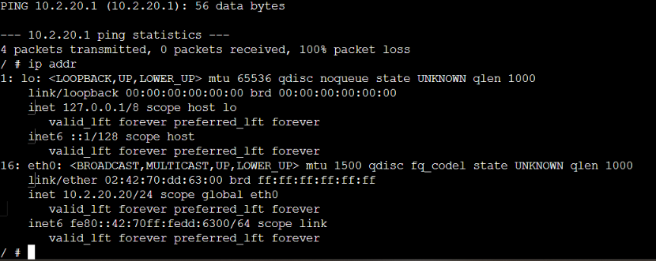

Shows the IDS-B management/interface IP configuration.

------------------------------------------------------------------------

## 25. IDS-B Routing Configuration

Shows routing configuration on IDS-B.

------------------------------------------------------------------------

## 26. OPNsense-B to IDS-B Connectivity

Shows successful connectivity from OPNsense-B to IDS-B.

------------------------------------------------------------------------

## 27. IDS-B to OPNsense-B Connectivity

Shows successful connectivity from IDS-B to OPNsense-B.

------------------------------------------------------------------------

## 28. Suricata-B Configuration

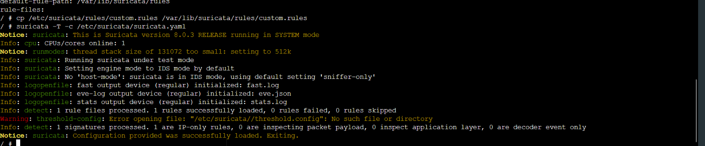

Shows the Suricata configuration used on IDS-B.

------------------------------------------------------------------------

## 29. Suricata-B Alert Detection

Shows Suricata generating/detecting an alert.

------------------------------------------------------------------------

## 30. Suricata-B Real Traffic Detection

Shows Suricata observing real Site B network traffic.

------------------------------------------------------------------------

# Week 2 - PKI / HTTPS Evidence

## 31. KDC-B OpenSSL

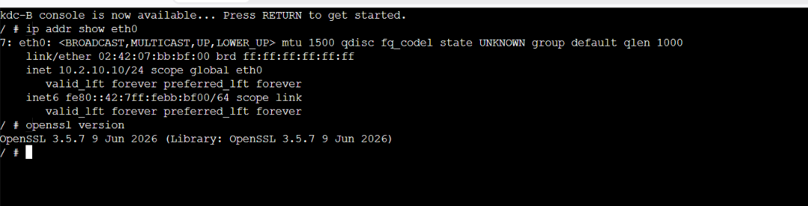

Shows OpenSSL available on KDC-B for Site B PKI work.

------------------------------------------------------------------------

## 32. Site B Root CA

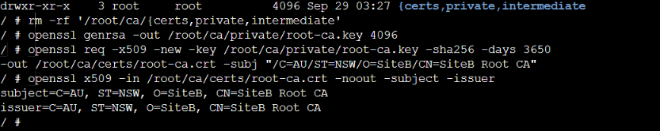

Shows creation/verification of the Site B Root CA.

------------------------------------------------------------------------

## 33. Site B Intermediate CA

Shows successful verification of the Site B Intermediate CA.

------------------------------------------------------------------------

## 34. web-B Certificate Signing Request

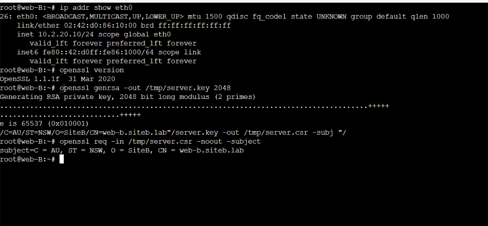

Shows the CSR generated for `web-b.siteb.lab`.

------------------------------------------------------------------------

## 35. web-B Certificate Files

Shows the certificate, CA chain and private key files available on
web-B.

------------------------------------------------------------------------

## 36. Nginx HTTPS Configuration Test

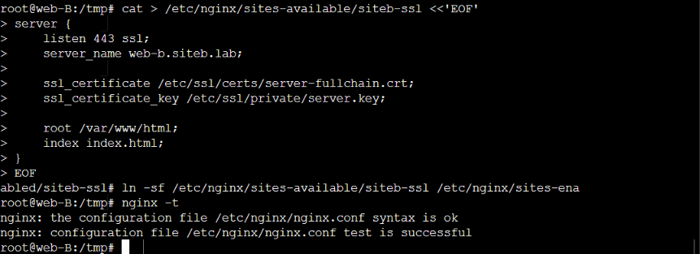

Shows the successful Nginx HTTPS configuration test.

------------------------------------------------------------------------

## 37. web-B HTTPS Port 443

Shows HTTPS port `443` listening on web-B.

------------------------------------------------------------------------

## 38. Client-B to web-B Connectivity

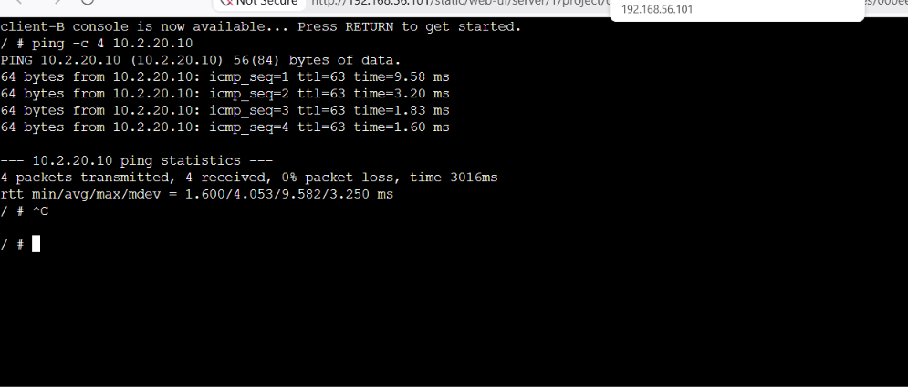

Shows successful network connectivity from Client-B to web-B.

------------------------------------------------------------------------

# Week 3 / Week 4 Evidence

## 39. Linux-B Connectivity

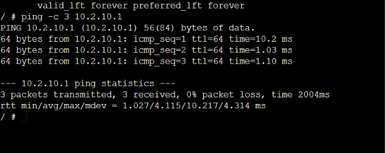

Shows the additional Linux security-testing host connected to the Site B
LAN with its assigned address/connectivity.

------------------------------------------------------------------------

## 40. Ed25519 SSH Key Generation

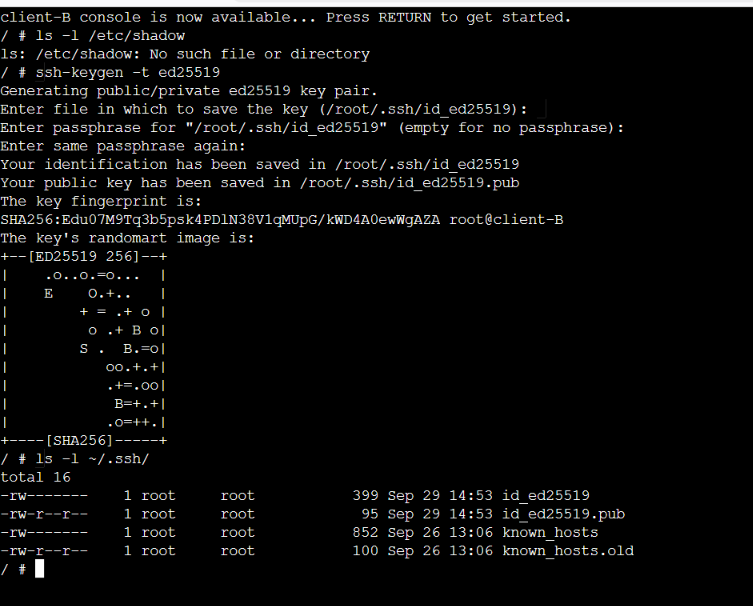

Shows generation of the Ed25519 public/private key pair for the Week 4
SSH security activity.

------------------------------------------------------------------------

# Evidence Status

The screenshots above document the Site B implementation completed so
far. Additional Week 3 password-policy and Week 4 SSH-hardening
screenshots should be added to the `Images/` folder and referenced here
after those activities are completed.

## Security Reminder

Do not upload any of the following to the repository:

-   Passwords
-   IPsec pre-shared keys
-   SSH private keys
-   Certificate private keys
-   Kerberos secrets
-   Tailscale authentication keys or login links
