# Secured Multi-Site Network - Security Justification Report

**Team:** Abishek (Site A, team lead) - Anima (Site B) - Umesh (Site C)
**Unit:** COIT12202 - Assessment 2

> **Draft status:** Sections 1-4 are drafted from Site A's completed build, with real evidence cited throughout. Sections 5-9 remain scaffolded (in *italics*) until VPN, Suricata, and Sites B/C exist - they need real content before submission, not filling in early with guesses. Anima and Umesh: add your sites' material into sections 3 and 4 alongside Site A's rather than replacing it, since the report needs to justify all three, not just one.

## 1. Scenario and assumptions

This build implements the assessment's scenario directly: three branch sites, one owned end-to-end by each group member, federated into a single security-consistent network. The assumptions below are ones the build actually depends on, not a general restatement of the spec.

- **WAN represents each site's path to the internet** via the host machine's own network adapter/NAT, not a real ISP circuit - reflected in how each site's Cloud/NAT node is wired directly to OPNsense's WAN interface.
- **Tailscale (or an equivalent bridged reachability layer)** solves a specific problem: three independently-hosted GNS3 topologies, each on a different physical machine, have no shared network to plug into. It is the *underlay* that makes cross-site reachability possible at all - it is not the encrypted link itself.
- **The site-to-site VPN tunnel (IPsec)** is the actual encrypted, audited connection carrying real inter-site traffic, built on top of that underlay. This two-layer design is deliberate: the assignment's "federate the sites" and "site-to-site VPN" requirements are two separate layers solving two separate problems, not duplicate work.
- **Addressing is agreed centrally** (`ADDRESSING.md`) before individual builds, with each site owning a distinct `/16` (Site A `10.1.0.0/16`, Site B `10.2.0.0/16`, Site C `10.3.0.0/16`) so that once tunnels exist, routing between sites is unambiguous.
- **The tunnel terminates on each site's OPNsense WAN address, not the VPN router** - stated directly in the unit's own lecture and reference slides, not a team preference.

## 2. Architecture overview

Each site runs an OPNsense firewall with WAN, LAN, and DMZ zones, a local Kerberos KDC serving that site's realm, and (once built) a Suricata sensor watching the DMZ. Site A additionally runs two firewalls rather than one - a deliberate extension, not a requirement. The three sites are identical in *structure* and differ only in addressing and realm name, which is what makes the cross-realm trust and VPN mesh tractable: every site expects the same shape from its peers.

The Tailscale-overlay-plus-VPN-tunnel distinction (Section 1) is the central architectural decision of this build. Without it, there would be no way to get three separately-hosted GNS3 instances talking to each other at all; without the VPN layer on top, whatever traffic did cross between sites would be unencrypted and unaudited.

*(Reference `network-diagram.drawio` for the full multi-site diagram.)*

## 3. Firewalls and zones

### Site A (Abishek) - complete

Site A runs two firewalls rather than one: `OPNsense1` (edge, facing the transit/Tailscale side) and `OPNsense2` (internal, handling LAN and DMZ). This is a deliberate design choice building on the individual Week 5/6 labs, not a requirement of the assignment specification - the course's own reference architecture shows a single firewall as sufficient.

**Addressing:**

| Zone | Firewall | Subnet | Gateway |
|---|---|---|---|
| WAN / transit | OPNsense1 | 10.1.9.0/24 | 10.1.9.1 |
| Inter-firewall | OPNsense1 to OPNsense2 | 10.1.8.0/24 | 10.1.8.1 / 10.1.8.2 |
| LAN | OPNsense2 | 10.1.10.0/24 | 10.1.10.1 |
| DMZ (OPT1) | OPNsense2 | 10.1.20.0/24 | 10.1.20.1 |

**A real bug, diagnosed and fixed, worth including as evidence of understanding rather than just following steps:** early testing showed `OPNsense1` unable to ping `OPNsense2` across the inter-firewall segment - 100% packet loss - despite both interfaces being correctly addressed and both showing as up. Unticking "Block private networks" and "Block bogon networks" on the WAN interface, the fix suggested by OPNsense's own documentation, made no difference. The actual cause: those two settings only remove *automatic* blocks, they do not add a Pass rule. WAN interfaces start with zero rules by default, so nothing was explicitly permitting the traffic through at all.

| Before the fix | After the fix |
|---|---|
| 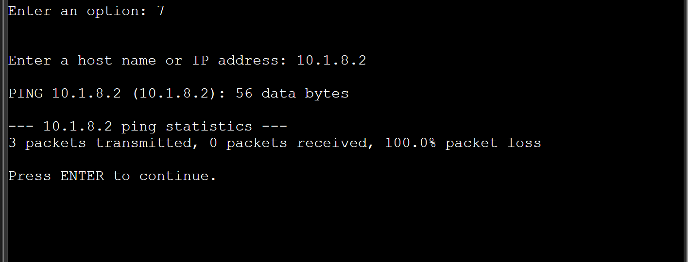 | 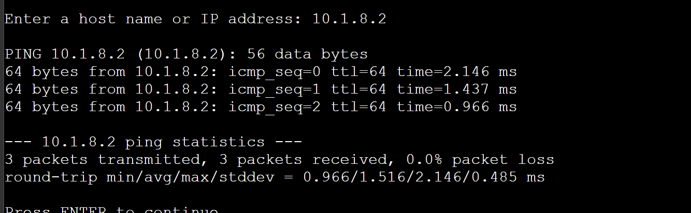 |

Adding an explicit Pass rule (source `10.1.8.0/24`, matching the inter-firewall segment) resolved it immediately, confirmed 0% packet loss both directions afterward.

**A second, related bug found later while extending this to the site-to-site VPN work, illustrating why source scoping needs care, not just presence:** when adding the equivalent WAN Pass rule needed for IPsec traffic arriving from the other two sites, the first attempt scoped the rule's source to Site A's *own* transit subnet (`10.1.9.0/24`) rather than the *remote* sites' transit subnets (`10.2.9.0/24`, `10.3.9.0/24`). Traffic arriving from another site over Tailscale will never have a source address inside Site A's own local subnet, so a rule scoped that way would never match the traffic it was meant to permit. The same mistake was independently caught during Site C's build using the identical rule pattern, which is what prompted re-checking Site A's own rule rather than assuming it was correct by precedent. Corrected to scope the source to the actual remote transit ranges.

**Current firewall rules, both firewalls:**

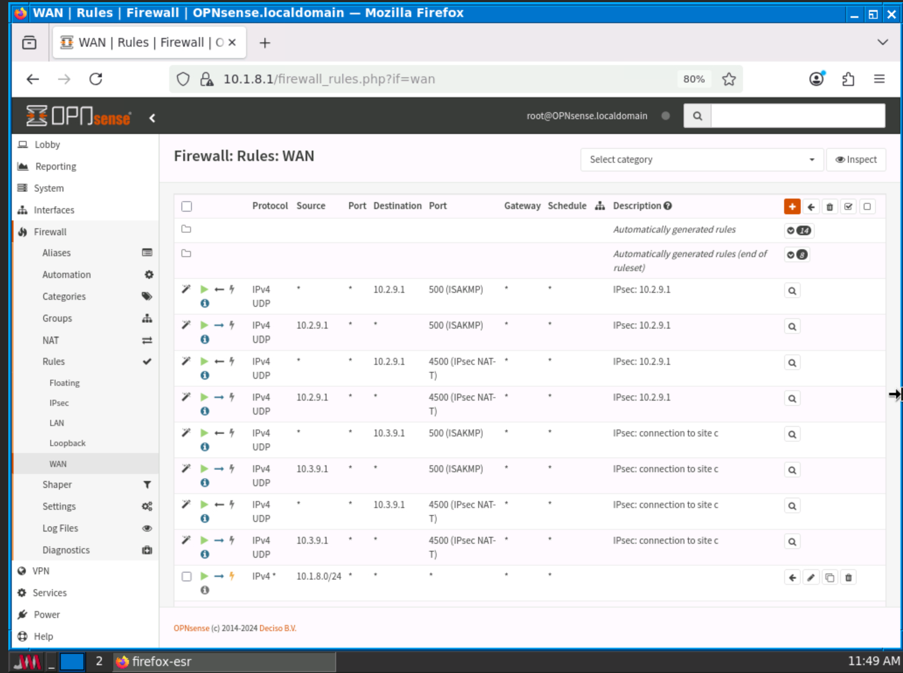

- `OPNsense1` WAN: Pass, source `10.1.8.0/24` (inter-firewall) and `10.2.9.0/24, 10.3.9.0/24` (remote site transit ranges, for IPsec)
- `OPNsense1` IPsec interface: Pass, source/destination any - added proactively before Phase 2 existed, since an unconfigured IPsec interface blocks all traffic by default the same way WAN does

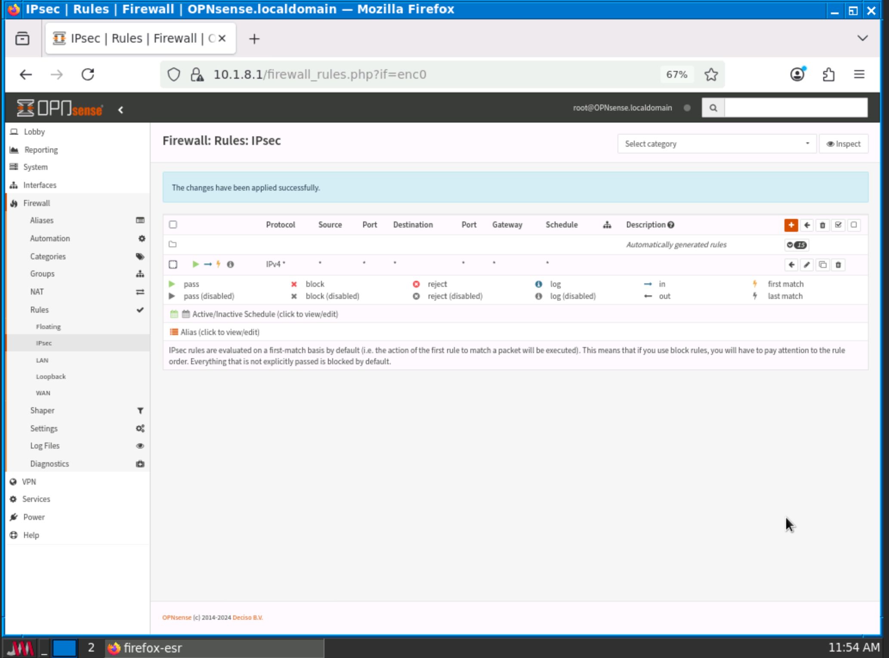

- `OPNsense2` WAN: Pass, source `10.1.8.0/24`
- `OPNsense2` OPT1 (DMZ): Pass, source OPT1 net

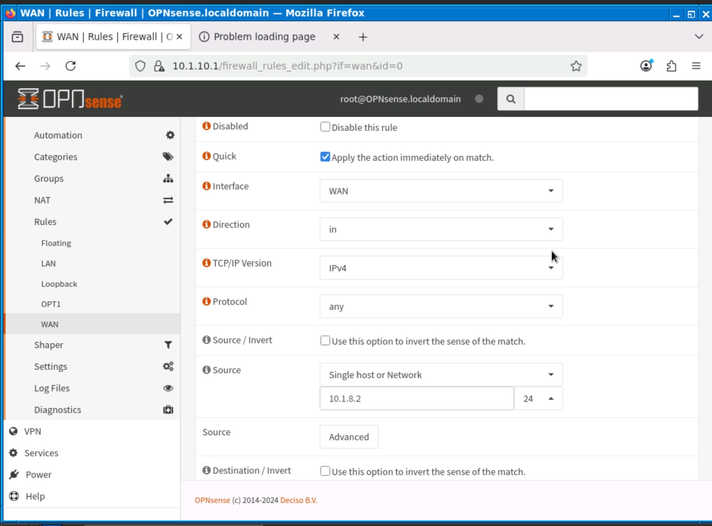

### Site B (Anima) and Site C (Umesh)

Both single-firewall builds, following the course's simpler reference architecture. Both independently hit the same "block-private-networks alone is not enough" WAN rule gap Site A found first, confirming this is a general OPNsense behaviour rather than something specific to the two-firewall design. Site C's build additionally surfaced the source-scoping error described above, which was then checked for and corrected on Site A's own equivalent rule as a result.

## 4. Enterprise authentication (Kerberos)

### Site A (Abishek) - realm `SITEA.LOCAL`, complete and proven

Site A runs its own Kerberos realm across three hosts on the LAN zone: `kdc` (`10.1.10.10`), `server` (`10.1.10.20`), and `client` (`10.1.10.30`), plus a Firefox-equipped `Host1` (`10.1.10.40`) used only for GUI access to OPNsense, not part of the realm. User principal: `abishek`.

The KDC database was initialised (`kdb5_util create -s`), and principals created for the user plus each host's service identity (`host/server.sitea.local`, `host/client.sitea.local`, `host/kdc.sitea.local`). The server's keytab was exported and transferred over HTTP within the LAN.

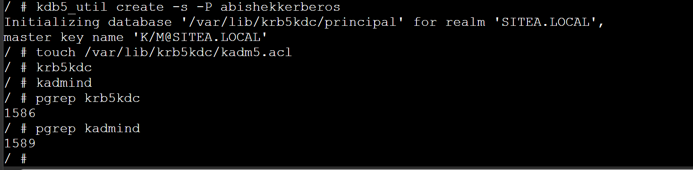

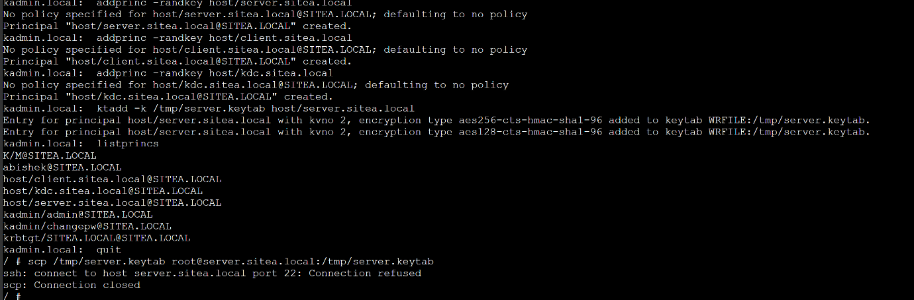

**Two genuine bugs hit and fixed, worth including as justification rather than omitting:**

First, once GSSAPI was enabled on `server`'s SSH daemon, login failed with a generic `Permission denied` and no useful reason at default verbosity. Running the SSH daemon in foreground debug mode revealed the actual cause: `platform_locked_account: password matches locked prefix '!'` - the `abishek` Unix account had been locked by an earlier failed `passwd` attempt, and a locked account blocks every authentication method, including GSSAPI, regardless of ticket validity. Every layer above this (keytab, GSSAPI config, the daemon itself) was already correct; this was purely a Unix account state issue, invisible until checked at debug verbosity. Fixed with `passwd -u abishek`.

Second, separately, `server`'s live kernel hostname was found to be `SERVER` (uppercase, no domain suffix) rather than `server.sitea.local`. Kerberos hostname matching is case-sensitive, so this alone would have blocked GSSAPI even with the account unlocked. The `/etc/hostname` file can say the right thing while the container runtime's live hostname says something else entirely - confirmed with the bare `hostname` command, not just the file. Fixed with `hostname server.sitea.local` followed by a daemon restart. This distinction, between a config file's stated value and a running process's actual state, is a useful thing to have diagnosed correctly rather than worked around.

**Proof, both directions:** with a valid ticket (`kinit abishek`), `ssh` to `server` using only `GSSAPIAuthentication`/`PreferredAuthentications=gssapi-with-mic` succeeded with no password prompt. After `kdestroy`, the identical command was refused (`Permission denied`). Running the same test twice with only the ticket's presence changed is the actual evidence that the login mechanism was Kerberos and not something else.

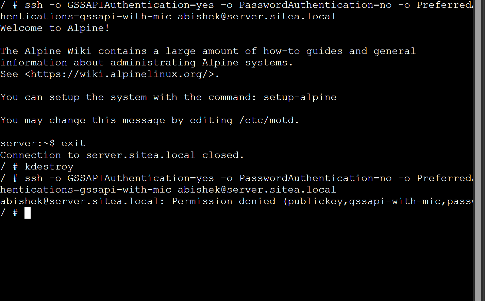

**Packet capture** (`SiteA_ByAbishek/captures/ClintToSwitchSiteA.pcap`, filter `kerberos`): six Kerberos packets rather than the minimum four, because `kinit` was run twice in immediate succession during capture, producing two full AS-REQ/AS-REP exchanges before the single TGS-REQ/TGS-REP pair from the SSH connection. The negative-proof attempt (after `kdestroy`) is also visible in the same capture as a TCP/SSH handshake with zero preceding Kerberos packets, closing in well under a second rather than completing a real session - consistent with the connection being refused before a service ticket could even be requested. Documented in full in `SiteA_ByAbishek/captures/README.md`.

**What's not yet done:** cross-*realm* trust between sites, the assignment's actual multi-site authentication requirement, cannot be built or demonstrated until Sites B and C have their own working KDCs. Site A's realm is built correctly to support that once they exist.

**Evidence:** `SiteA_ByAbishek/Images/kerberos-02` through `-04`, `SiteA_ByAbishek/configs/kerberos-summary.md` for the complete command-by-command record.

### Site C (Umesh) - not yet built

*No Kerberos hosts exist yet at Site C. Once it has its own KDC (realm `SITEC.LOCAL`), this section needs Site C's build documented in the same pattern as Site A above, followed by the cross-realm trust configuration and proof that is the actual multi-site deliverable.*

### Site B (Anima) - in progress

*Real Kerberos work exists at Site B (KDC, principals, keytab, a client ticket, a service ticket, and GSSAPI SSH shown enabled), evidenced in screenshots. A full positive/negative login proof in the same pattern as Site A's above, and the write-up of this section with her own real detail, is pending directly from Anima.*


## 5. Site-to-site VPN

### Design decisions

**Tunnel type: IPsec, IKEv2, policy-based, pre-shared key.** Chosen over WireGuard because IPsec is built into OPNsense's base system with nothing to install, while WireGuard needs the `os-wireguard` plugin, which depends on reliable internet access to OPNsense's package repositories - a real risk given how unreliable WAN reachability proved to be at several points during this build, not a hypothetical concern.

**Tunnel termination: each site's OPNsense WAN address, not the VPN router.** This is stated directly in the unit's own lecture and reference slides - "the tunnel runs firewall WAN to firewall WAN, inside the Tailscale network" - not a team preference. `VPNRouter1` provides the Tailscale underlay only; `OPNsense1` (specifically, the edge firewall, not `OPNsense2`) is the actual tunnel endpoint.

**Phase 2 subnet pairing: each site's full advertised `/16`, not just LAN.** Agreed centrally in `ADDRESSING.md` before individual configuration began, so both ends of every pairing would match without needing to renegotiate scope later.

### Underlay: Tailscale

Both site-to-site pairings have working Tailscale connectivity, confirmed directly rather than assumed:

- **Site A to Site B:** confirmed via a direct ping from `VPNRouter1` to Site B's `OPNsense-B` WAN address, 0% packet loss, after Site B independently hit and fixed the same "ARP resolves but ping fails" WAN rule gap described in Section 3.
- **Site A to Site C:** `tailscale status` confirms both `VPNRouter1` and `VPNRouter-C` connected on the shared tailnet, with real traffic already exchanged between them (non-zero tx/rx). Direct connectivity to `OPNsense-C`'s WAN specifically has not yet been confirmed working - the same WAN rule gap was found on Site C's side, compounded by a second error (the rule's source was scoped to Site C's own transit subnet rather than the remote sites' subnets, which would never match incoming traffic regardless of the rule's presence). The fix has been communicated; re-confirmation is still pending as of this writing.

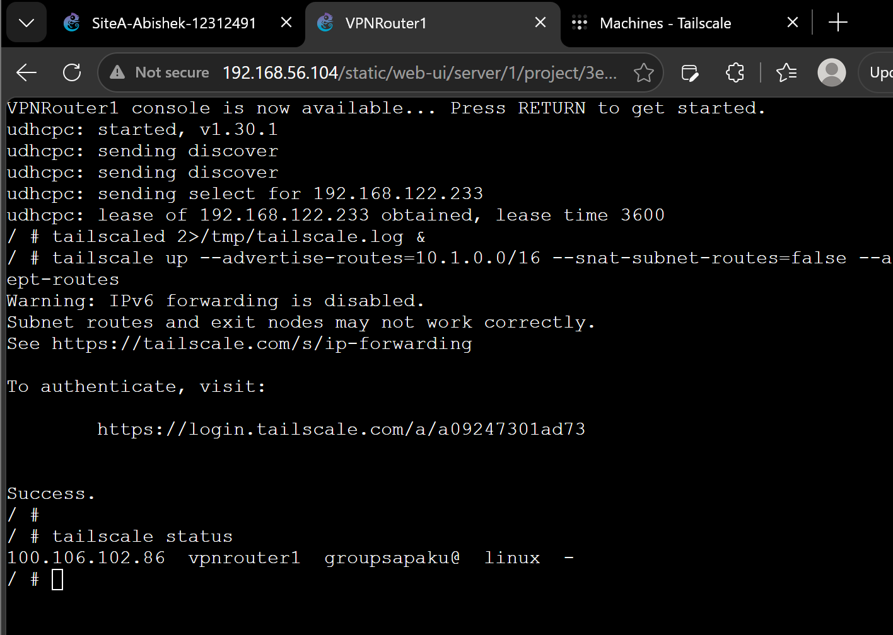

### Phase 1 (IKE)

Configured on `OPNsense1` for both peers: `10.2.9.1` (Site B) and `10.3.9.1` (Site C), both IKEv2, both 256-bit AES-GCM with a 128-bit ICV, SHA256 hash, DH group 14, PSK authentication. Both enabled.

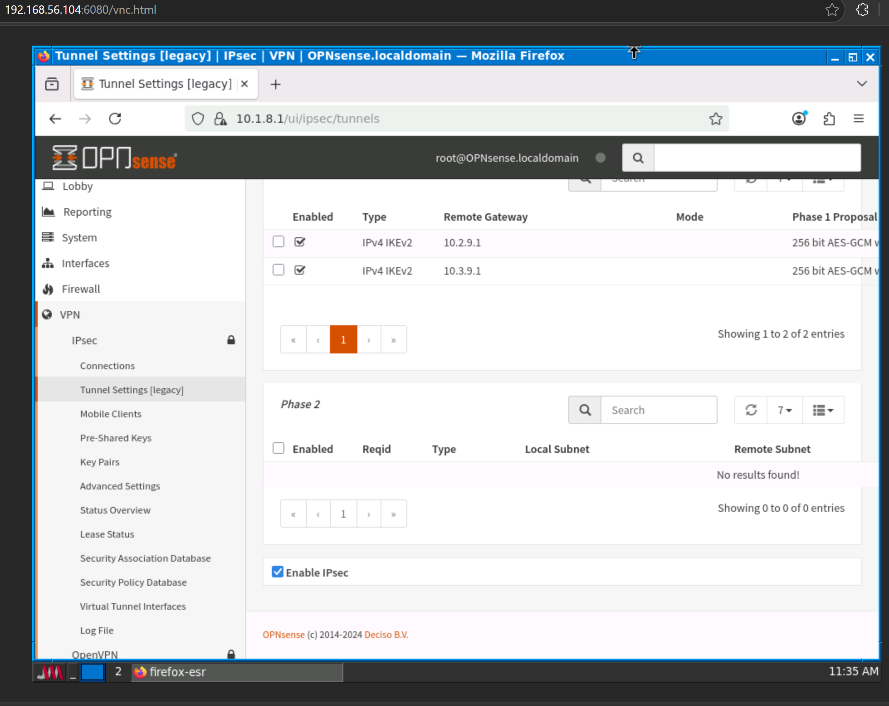

Firewall rules for both tunnels confirmed in place on `OPNsense1`'s WAN (auto-generated UDP 500/4500 and ESP rules for each peer) and, separately, an explicit Pass rule added on the IPsec interface itself before Phase 2 existed - an unconfigured IPsec interface blocks all traffic by default the same way a fresh WAN interface does, so this was added proactively rather than reactively. See Section 3 for the full rule detail and the source-scoping bug this surfaced.

### Phase 2

Configured on `OPNsense1` for both peers, using the agreed `/16` pairing:

| Peer | Local network | Remote network |
|---|---|---|
| Site B | 10.1.0.0/16 | 10.2.0.0/16 |
| Site C | 10.1.0.0/16 | 10.3.0.0/16 |

**Site A <-> Site C:** both sides now have matching Phase 2 entries (Site C's local = `10.3.0.0/16`, remote = `10.1.0.0/16`, mirroring Site A's own configuration). The WAN-upstream-gateway bug that was preventing IKE from completing has also been found and fixed independently on both firewalls, so both sides of this pairing are finally symmetric and ready for a fresh connectivity test - this is the immediate next step rather than a remaining configuration gap.

**Site A <-> Site B:** Phase 2 is configured on Site A's side; confirmation that Anima's entries mirror this (her local = `10.2.0.0/16`, remote = `10.1.0.0/16`) is still pending as of this writing.

Phase 1 establishing correctly on both pairings was itself the prerequisite for this step, and that groundwork is confirmed done on both.

### Still required (not yet possible)

The before/after packet capture pair required for this section cannot be produced until a Phase 2 pairing actually installs on at least one tunnel - there is no real inter-site traffic to capture until then. This is the one piece of Site A's VPN work still genuinely blocked on another site's configuration, rather than something solvable independently.


## 6. Intrusion detection (Suricata)

### Site A (Abishek) - complete and proven

`IDS1` sits on `Hub1` in the DMZ, tapping traffic to and from `Host6` (`10.1.20.30`) - a hub, unlike a switch, broadcasts to every connected port, which is what makes passive monitoring possible without needing a dedicated mirror port. `Host5` (`10.1.20.20`) generates the test traffic that crosses that segment.

**Two custom rules**, added to `/var/lib/suricata/rules/custom.rules`:

- `sid:1000001` - alerts on an HTTP request whose User-Agent header contains the string `BadBot`, classified as a web application attack.
- `sid:1000002` - alerts on any outbound TCP connection to port 4444, classified as trojan activity (a common default port for reverse-shell tooling).

`HOME_NET` was already set to `10.0.0.0/8` by default, which covers Site A's `10.1.20.0/24` DMZ without needing to edit `suricata.yaml`.

Both rules validated cleanly before the engine was started:

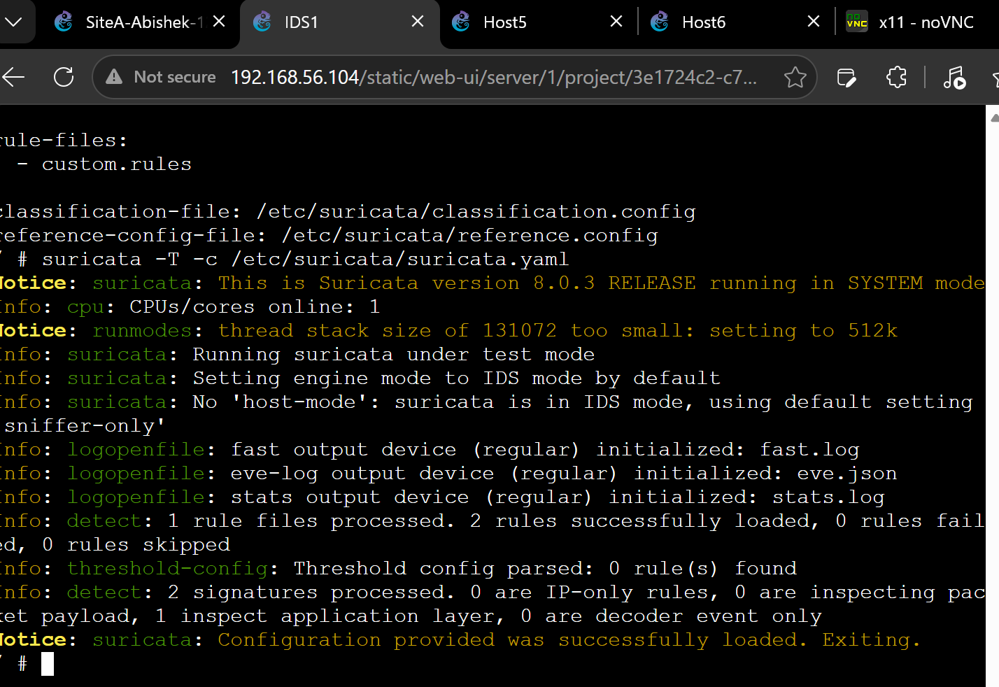

**Both rules triggered and confirmed:**

```
curl -A "BadBot" http://10.1.20.30/
```

from `Host5` to `Host6`'s web server produced an immediate alert for `sid:1000001`. A plain `curl` with no matching User-Agent, run immediately after as a negative control, produced no alert - confirming the rule matches on the header content specifically, not just the presence of HTTP traffic.

```
echo "test data" | nc 10.1.20.30 4444
```

against a listener running on `Host6` produced an alert for `sid:1000002`.

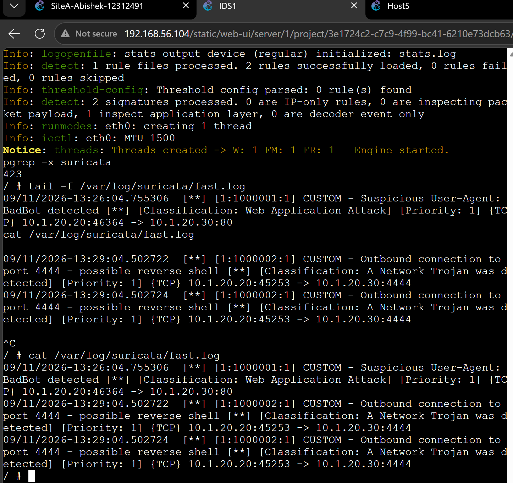

**The traffic that triggered it, cross-checked against an independent source:** rather than relying on Suricata's own alert as the only evidence, the underlying HTTP request and its arrival at `Host6` were confirmed separately.

| | |
|---|---|
| 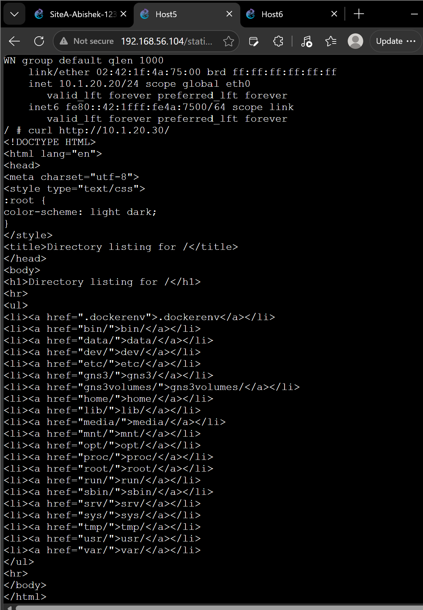 | 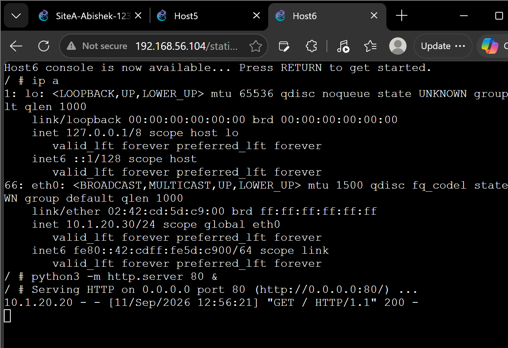 |
| `Host5` (`10.1.20.20`) curls `Host6`'s web server | `Host6`'s own web server access log shows the same request, matching Suricata's alert source and destination exactly |

This cross-check matters: it demonstrates the alert corresponds to real, independently-verifiable traffic, not a false positive or a misconfigured test.

**A known limitation of the current wiring, worth stating rather than glossing over:** `IDS1` only sees traffic where `Host6` specifically is the source or destination, since `Host6` is the only leaf host actually sitting on the hub segment - `WEB-A` connects through `Switch3`, a real switch, which only forwards traffic to where its destination actually is. General DMZ traffic not involving `Host6` is therefore not currently visible to the sensor. The test traffic above was deliberately routed through `Host6` to work within this constraint rather than ignore it; a more complete deployment would connect every DMZ host directly to the hub instead of through a switch, so all DMZ traffic is visible, not just traffic to one specific host.

**Evidence:** `SiteA_ByAbishek/Images/suricata-ids1-rules-loaded.png`, `suricata-ids1-alerts-fired.png`, `host5-curl-host6-webserver.png`, `host6-access-log-confirms-host5-request.png`.

### Site C (Umesh) - configured and proven

`IDS-C` (`10.3.20.20`) validated cleanly and loaded its custom ruleset without errors. ICMP traffic between `web-C` (`10.3.20.10`) and `IDS-C` produced a `SITE-C ICMP Ping Detected` alert in `fast.log`, confirmed in Site C's own evidence. Additional custom rules were added and tested during this work.

The same wiring limitation described above for Site A is worth checking on Site C before assuming the sensor sees general DMZ traffic, not just traffic to/from the specific host it is wired to - this should be confirmed (or ruled out) in Site C's own write-up.

**Evidence:** see `SiteC_ByUmesh/README.md` and its screenshots for the full detail.

### Site B (Anima) - in progress

*Suricata has been configured at Site B, with a real alert fired against real traffic (evidenced in screenshots) rather than just a clean rule-load screenshot. The exact ruleset, rule IDs, and the same cross-check pattern used for Site A and Site C (an independent confirmation that the triggering traffic actually arrived, not just Suricata's own alert) still need writing up with her own detail directly from Anima, along with checking for the same hub-vs-switch visibility limitation described above.*


## 7. Defence-in-depth and trust boundaries

*Tie the previous sections together - where do overlapping controls exist? Where is trust granted between sites, and why is that boundary justified rather than just convenient?*

## 8. Wireless extension (required - design only)

*Wireless-specific threats (e.g. evil twin, deauthentication, KRACK/4-way-handshake capture, rogue access points) and the defences you'd deploy to extend this architecture to wireless (e.g. WPA3-SAE/Enterprise, 802.1X with EAP-TLS and RADIUS, management-frame protection, SSID-to-VLAN segmentation, wireless IDS). Tie every choice back to your existing trust boundaries - nothing wireless is built.*

## 9. Conclusion

*Brief summary of what was achieved and any known limitations.*

## References

*List sources cited above.*
